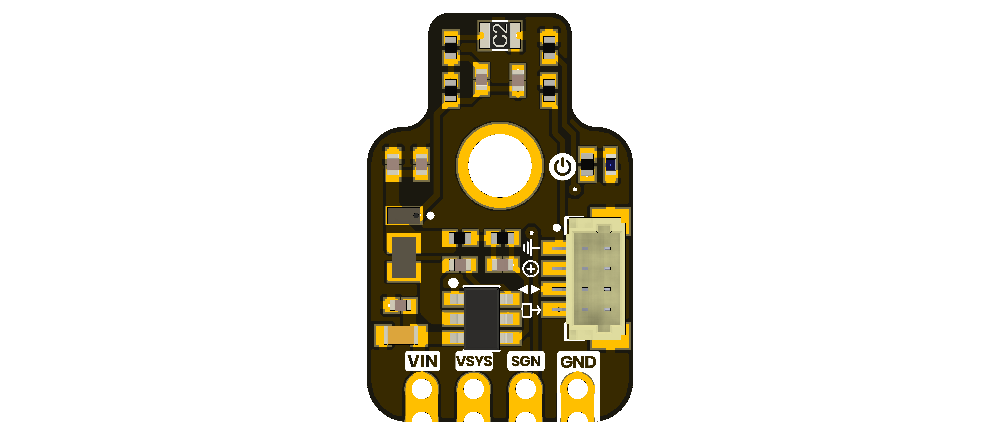

# DevLab I2C HX0805-C2 Vibration Sensor

The DevLab I2C HX0805-C2 Vibration Sensor is an I2C vibration sensing module in the UNIT Electronics DevLab family.

  
  
<em>DevLab I2C HX0805-C2 Vibration Sensor</em>

### Quick Setup

## Overview

| Feature | Description |
|---|---|
| Product | DevLab I2C HX0805-C2 Vibration Sensor |
| MPN | UE0144 |
| Interface | I2C |
| Available visuals | Product-specific top and bottom board views |
| Factory I2C Address | `0x25` (7-bit) |
| DDP Device ID | `0x0105` |

## Applications

- Vibration detection and event monitoring.
- Mechanical movement experiments.
- I2C sensor integration prototypes.

## Resources

- [Schematic diagram](hardware/unit_sch_v_1_0_0_ue0144_x0805_vibration_sensor.pdf)
- [Hardware files and board views](hardware/README.md)
- [Product reference source](tools/product-reference/README.md)
- [Generic I2C scanner examples](software/README.md)
- [Controller firmware repository](https://github.com/UNIT-Electronics-Labs/unit_firmware_i2c_hx0805_py32)

The latest schematic is revision 1.0.0; confirm it matches the physical board. Check the product-specific pinout or schematic for wiring and electrical limits.

The Arduino support-library link has not been confirmed for this module.

## 📝 License

All hardware and documentation in this project are licensed under the **MIT License**.
See the [repository license](LICENSE) for details.
