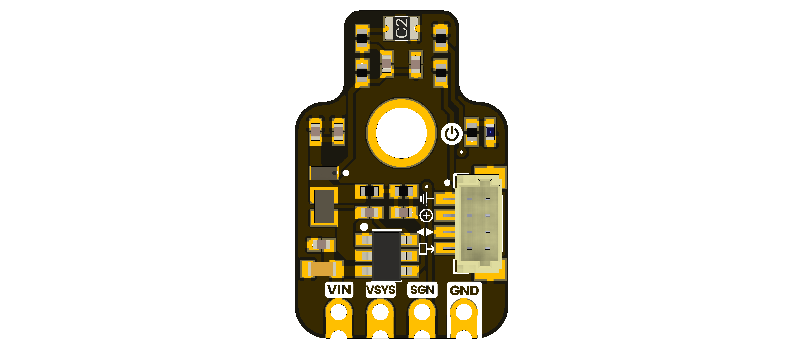
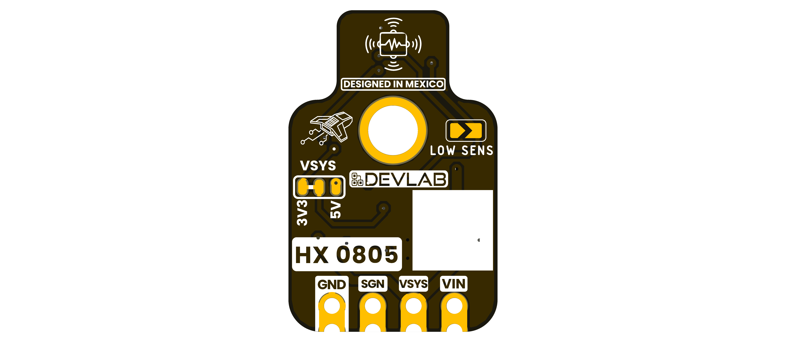

# DevLab I2C HX0805-C2 Vibration Sensor

MPN: **UE0144**

## Board Views

## Pinout

A product-specific pinout drawing was not included in the selected source package.

Board renders show the supplied layout. Confirm electrical limits, connector
orientation, and mechanical tolerances against product-specific drawings before
using the board in a final assembly.

## Schematic

[UE0144 Rev 0.0.1 schematic](unit_sch_v_0_0_1_ue0144_hx0805_c2_vibration_sensor.pdf)
